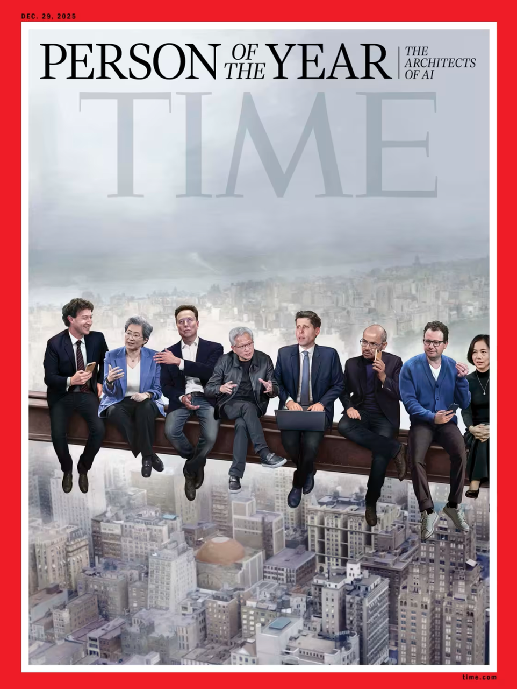

# 从ImageNet到LLM：一场关于“第一性原理”的深度学习革命

## 引言：两种“反直觉”的持续专注

2022年底ChatGPT横空出世时，世人惊叹于大语言模型（LLM）的“涌现能力”。但很少有人意识到，这场变革的种子早在十几年前就已埋下——2009年，当李飞飞发布包含1500万张图像的ImageNet数据集时，学界反应冷淡，在当年的计算机视觉与模式识别大会上仅以海报形式展示，影响力“微乎其微”。

当时的主流信念是：**算法才是智能的核心**。如果把机器智能比作生物大脑，算法就是神经回路——有什么比让这些回路变得更好、更快、更强大更重要的呢？

但李飞飞看到的是另一层本质。**她的“第一性原理”式追问是**：如果训练算法的数据不能反映真实世界的复杂性，再好的算法又如何真正理解世界？

这一追问，奠定了一条从ImageNet到LLM的完整技术脉落。

## 第一幕：ImageNet——用数据“看见世界”

### 从WordNet到图像宇宙

ImageNet的灵感来源于语言学家乔治·米勒创建的WordNet——一个按语义关联组织词汇的庞大数据库，包含超过14万个英文单词。李飞飞意识到，**既然语言可以被系统性地“映射”，视觉世界同样可以**。

她的目标野心勃勃：为22000个物品类别各收集1000张图片，总计约2000万张。这意味着要从近10亿张候选图片中筛选，由来自167个国家的近5万名贡献者手工标注、三重验证。

最初，团队支付本科生每小时10美元手动搜索图片，很快算了一笔账：按这个速度，完成项目需要**19年**。尝试用机器辅助标注又陷入悖论——如果机器能准确识别物体来帮助标注，ImageNet本身就失去了意义。

最终的解决方案来自“亚马逊土耳其机器人”（Amazon Mechanical Turk）——一个众包平台。这让标注团队从几十个本科生转变为数千人的国际协作力量。

### 被冷落的“北极星”

ImageNet于2009年发布时，并未立即获得认可。2010年和2011年的ImageNet大规模视觉识别挑战赛（ILSVRC），获胜算法仍是当时流行的支持向量机，准确率仅略有提升。参赛人数从150人骤降至96人，算法从35个减至15个。

**李飞飞后来将这项事业称为她的“北极星”——一个指引方向、值得长期投入的使命**，而非追求即时认可。

## 第二幕：AlexNet——当算法终于“看见”数据

### 老古董的逆袭

2012年9月30日，AlexNet以**85%的识别准确率**赢得ILSVRC冠军，比前一年高出10个百分点，创造了世界纪录。

令人意外的是，AlexNet采用的不是当时的前沿算法，而是被视为“尘封艺术品”的**神经网络**——卷积神经网络（CNN）的一个实例，灵感来自休伯尔和威塞尔对哺乳动物视觉系统的观察。

AlexNet的设计体现了深刻的生物启发性：像视网膜一样，最外层将成千上万个“感受野”应用于图像像素，每个感受野经调整识别独特的微小图案（如边缘、纹理、明暗交替），信号逐层汇聚融合，最终形成完整的物体识别——**整个过程完全依靠数据驱动，数十万个神经元在没有人工干预的情况下自主学习敏感度**。

### “数据”终于被看见

AlexNet的成功揭示了一个关键事实：**不是神经网络突然变聪明了，而是ImageNet提供了让神经网络“睁开眼睛”的足够数据**。图灵奖得主杰弗里·辛顿后来评价：“李飞飞是第一位真正理解大数据力量的计算机视觉研究人员，她的工作打开了深度学习的闸门。”

李飞飞自传中的一段话或许最能概括这一时刻的意义：“**生物进化是宇宙中唯一能够从零开始创造真正智能的力量，我觉得我们正在复原其线路图。** ”

## 第三幕：从视觉到语言——LLM如何继承ImageNet的遗产

|分类|ImageNet干了啥|LLM是怎么继承的|
|---|---|---|
|**网络怎么搭（架构）**|发明了**残差连接（跳线）**：信号可以直接“跳”过几层传过去，解决了网络太深会“学废了”的问题。|Transformer里到处都是这种“跳线”设计，没有它，现在的LLM根本堆不到上百层。|
|**怎么训练（范式）**|开创了**先在大数据上预训练，再在小任务上微调**的模式，相当于先上完大学再针对具体岗位培训。|现在的LLM全是这套路：先在海量文本上预训练，再针对问答、翻译等任务做微调。|
|**数据有多重要（认知）**|用上千万张图证明了：**数据越多、越杂，模型越聪明**。|直接给了LLM信心去“吃”海量文本数据，催生了“规模定律”——大力出奇迹。|
|**注意力怎么来的（组件）**|当时用**边框标注**（框出图中猫在哪）来教模型看重点。|被升级成了**自注意力机制**，模型自己学会判断哪些词更重要，不用人教了，这是Transformer的灵魂。|
|**越深就越好吗（规律）**|发现层数多确实有用，但得配上残差连接这种“保命”措施，不然深了反而更差。|LLM延续了这个信念，但后来也发现，深到一定程度收益会变小，不是说无脑堆层就完事。|

### 同样的“第一性原理”

2017年，Google团队在论文《Attention is All You Need》中提出Transformer架构，标志着LLM时代的起点。Transformer的核心创新——**自注意力机制**——让模型能够动态权衡每个词元相对于其他词元的重要性，捕捉长距离依赖关系，同时支持并行计算。

但**LLM革命的真正基础，是继承了ImageNet奠定的方法论**：

1. **数据的核心地位**：GPT\-3在2020年以1750亿参数证明，模型性能随着参数规模、数据集大小和计算量的增加而平稳提升——这正是李飞飞早在2006年就预言的“规模效应”。

    

2. **自监督学习的范式**：与ImageNet依赖人工标注不同，LLM采用自监督学习——通过预测被遮盖的词（类似BERT的掩码语言建模）或预测下一个词（GPT的自回归方式）来训练。但底层逻辑一致：**让模型在海量、多样、反映真实世界的“经验”中自主学习规律**。

    

3. **“涌现能力”的验证**：当GPT\-3展示出少样本和零样本学习能力时，它验证了一个从ImageNet时代就埋下的假设：**足够大的模型在足够多的数据上训练，会产生超出设计初衷的智能**。

    

### 一个传承的故事

李飞飞在Lenny's Podcast中总结道，现代AI成功的底层架构高度稳定，本质上都是 **“大数据\+神经网络\+强大算力”** 的规模化扩展。从ImageNet到AlexNet，再到GPT系列，**三要素的每一次规模化，都带来了能力的质变**。

她同时指出，人类智能高度依赖视觉感知——**视觉是理解物理世界的基础，因此她从视觉切入AI研究是“自然而合理的路径”**。这一洞见如今正被多模态大模型（如GPT\-4、Sora）验证——当LLM开始“看见”图像、视频和音频，它们正在获得更接近人类理解世界的方式。

## 洞察：我们从这个历程中学到了什么

### 1\. 第一性原理：追问本质，而非追逐热点

李飞飞的故事最深刻的启示在于：**她拒绝了当时“算法至上”的共识，回归到“智能如何形成”的本质问题**。当所有人都专注优化算法时，她追问的是“如果认知依赖于经验，那么机器的经验从哪里来？”这个追问催生了ImageNet。

在LLM时代，同样的问题值得我们继续追问：当数据规模接近互联网语料的极限，下一步的“经验”从哪里来？是合成数据、物理世界交互，还是全新的学习范式？

### 2\. 持续专注：在冷板凳上守护“北极星”

ImageNet在2009年发布后并未立即获得认可，参赛人数甚至出现下降。李飞飞在自传中回忆，支撑她坚持下去的是对“北极星”的信念——一个值得长期投入的方向，而非短期的认可或回报。

**这一品质在今天的AI领域尤为珍贵**。当资本和舆论追逐一个又一个“元年”，真正的突破往往来自那些愿意在冷门方向深耕多年的研究者。

### 3\. 数据的哲学：

### 分类即认知的基础

李飞飞在自传中写道：“**视知觉依赖于分类。我们的大脑会自然而然地将我们所看到的细节归类为更广泛的概念。** ” ImageNet的本质，就是为机器建立了一个“分类体系”，让算法通过数千万张标注图像学习“什么是猫、什么是狗、什么是树”。

**LLM的语言理解同样建立在“分类”之上**——通过预测词与词之间的关系，模型学会了语法、语义，甚至推理。从视觉到语言，深度学习底层贯穿着同一个认知逻辑：**智能的核心能力是对复杂世界进行有意义的分类和关联**。

### 4\. 反直觉的勇气：从“算法中心”到“数据中心”

ImageNet的核心理念在当时是**反直觉的**：与其设计更精巧的算法，不如构建更大的数据集。李飞飞团队甚至刻意拒绝了机器辅助标注，以确保ImageNet的每张图片都“嵌入纯粹的人类感知”。

同样，Transformer的提出也**颠覆了RNN/LSTM以“顺序处理”为基石的范式**，用自注意力实现了完全并行化。**真正的创新往往来自于“重新定义问题”，而非在旧框架内优化答案**。

## 结语：我们仍处于“看见世界”的早期

李飞飞曾说：“**无论生活把我带向何方，我都觉得自己永远处于一种脆弱的状态。** ”这种“脆弱”感，或许正是她保持开放和持续探索的原因。

从ImageNet到LLM，深度学习用近二十年完成了一次“螺旋式上升”的验证：**最初为“让机器看见物体”而构建的数据和算法体系，最终演化为“让机器理解语言和世界”的通用框架**。

但李飞飞也在最新的访谈中提醒我们：当前AI仅实现了“部分智能”，仍处于皮毛探索阶段。**实现更高层次的智能，不能单纯依赖扩大数据与模型规模，更需要底层算法的根本性创新**。

**从视觉到语言，从“看见”到“理解”，我们正站在从“感知智能”迈向“认知智能”的门槛上。而这场旅程的核心命题，始终是李飞飞在二十年前就提出的那个追问**：如何让机器像人类一样，从真实世界的经验中生长出智能？

答案或许正在生成之中。

---

### ImageNet历届冠军模型概览（2012\-2017）

下表汇总了从深度学习引爆点开始，各年的主要冠军模型及核心信息。

| 年份 | 获奖模型 / 团队 | Top-5 错误率 | 核心理念与价值 |
| :--- | :--- | :--- | :--- |
| **2012** | **AlexNet** (多伦多大学, 辛顿团队) | **16.4%** | **理念**：首次将深度卷积神经网络（CNN）与GPU并行计算大规模结合，并使用了ReLU、Dropout等技巧。 **价值**：引爆深度学习革命，证明了深度模型在大规模数据上的巨大潜力，开启了AI的新时代。 |
| **2013** | **ZF Net / Clarifai** (Matthew Zeiler) | **11.7%** | **理念**：对AlexNet的结构超参数进行了微调，通过可视化技术揭示了神经网络中层特征的含义。 **价值**：推动了模型的可解释性研究，其创办的公司Clarifai获得了数千万美元融资，展示了学术成果商业化的路径。 |
| **2014** | **GoogLeNet** (Google) | **6.7%** | **理念**：提出Inception模块，通过在网络同一层使用不同尺寸的卷积核并行处理，再融合结果，在不增加过多计算量的情况下大幅增加网络宽度和深度。 **价值**：证明了网络结构的创新是提升性能的关键，为后续更复杂的架构设计提供了思路。其亚军VGGNet则强调了网络深度的重要性，其简洁的结构至今仍被广泛用作特征提取器。 |
| **2015** | **ResNet** (微软亚洲研究院) | **3.57%** | **理念**：引入残差连接（Residual Connection），让网络学习输入与输出的"残差"，解决了极深网络（152层）的梯度消失和退化问题。 **价值**：首次超越人类识别水平（约5.1%），证明了"越深越好"的可能性，其思想成为后续几乎所有强大模型的基石。 |
| **2016** | **Trimps-Soushen** (中国团队) | **2.99%** | **理念**：在ResNet等优秀模型基础上进行模型融合和超参数调优，将错误率进一步降低。 **价值**：标志着中国团队在计算机视觉领域的全面崛起，来自商汤、港中文、海康威视等机构的队伍包揽了当年多个项目的冠军。 |
| **2017** | **SENet** (Momenta & 牛津大学) | **2.25%** | **理念**：提出Squeeze-and-Excitation（SE）模块，通过学习的方式自动获取每个特征通道的重要程度，对重要特征进行强化，对不重要特征进行抑制。 **价值**：在最后一届比赛中夺冠，代表了注意力机制在CNN中的成功应用的先声。 |
**参考文献**

1. 澎湃新闻，《在ChatGPT出现之前，李飞飞的ImageNet如何奠定了人工智能的技术革命？》，2024 

2. 小红书，《读李飞飞自传的时候就像在和心理医生对话》，2025 

3. Proceedings of Machine Learning Research, “Elucidating the design space of language models for image generation”, 2025 

4. Cambridge University Press, “The Deep Learning Revolution in AI”, 2025 

5. 微信公众号，《大语言模型简史：从Transformer（2017）到DeepSeek\-R1（2025）的进化之路》，2025 

6. 百家号/财经网，《《我看见的世界：李飞飞自传》｜在ChatGPT出现之前，ImageNet如何奠定人工智能技术革命？》，2024 

7. The Business Times, “AI firms will soon exhaust most of the Internet's data”, 2024 

8. 智源社区，《从ImageNet到AlexNet，李飞飞万字自述人工智能诞生的关键进程》，2024 

9. 小红书，《分享李飞飞在Lenny播客的AI观点》，2025

