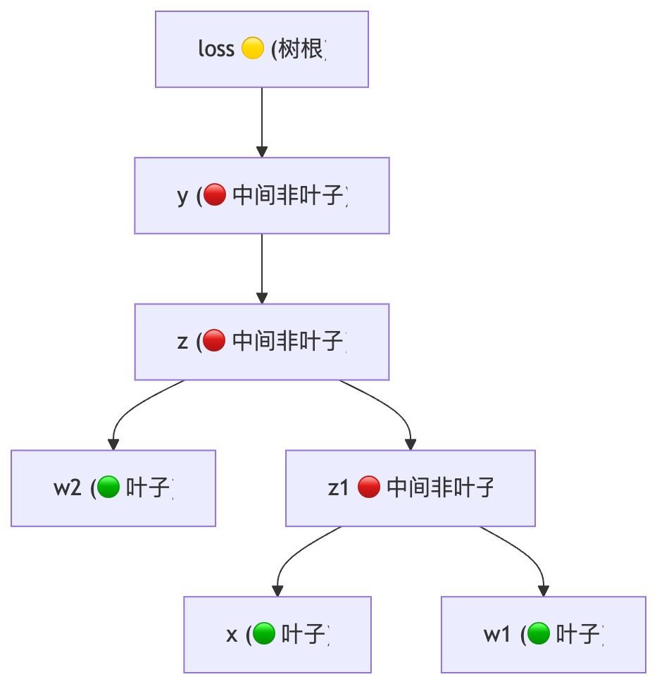
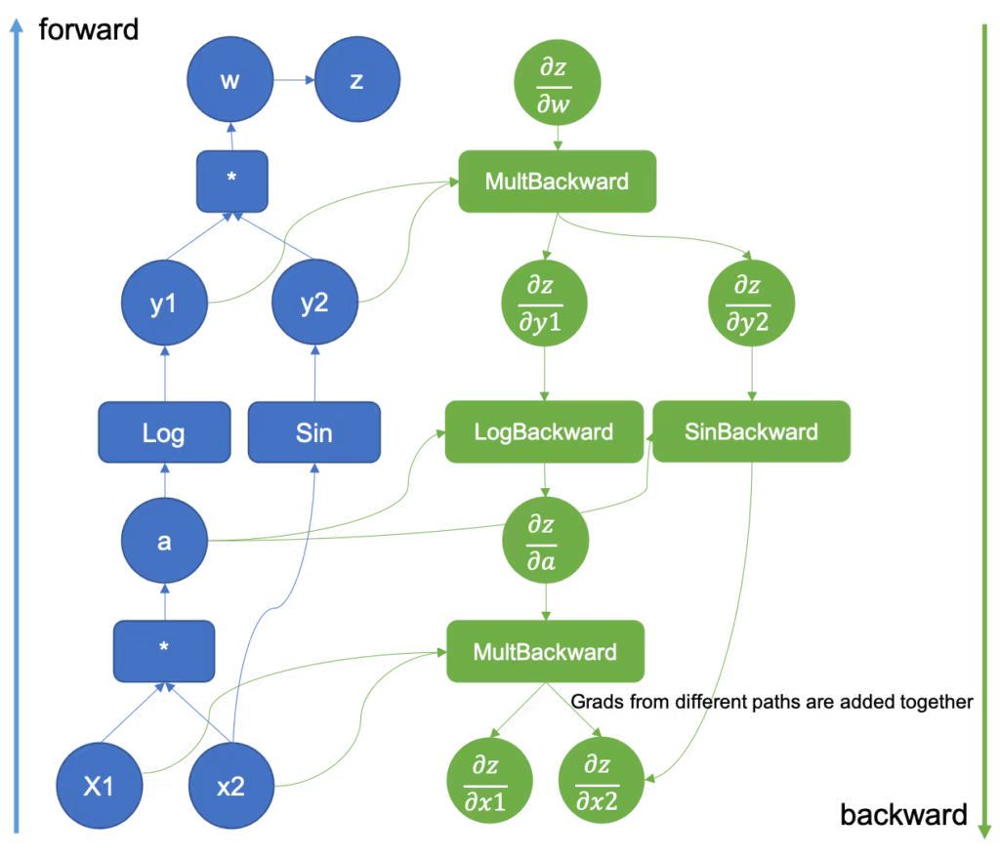

# ⚙️ PyTorch 核心机制参考 · Autograd

# Autograd 机制

## 计算树结构（树根 = loss，向下生长）

**图例：**

- 🟡 **根节点**：loss

- 🔴 **中间节点**：y, z, 合并节点（由运算生成）

- 🟢 **叶子节点**：x, w1, w2（用户初始化）

    

**流向：**

- **前向**：叶子 x, w1, w2 → 中间 z → 中间 y → loss

- **反向**：loss → y → z → 同时分流至 x / w1（上游）及 w2

---

### 🔹 核心规则确认（PyTorch 官方文档）

**梯度累积对象：**“在反向传播 \(`.backward()`\) 期间，**只有 ****`requires_grad=True`**** 的叶张量 \(leaf tensors\)** 的梯度才会被累积到其 `.grad` 字段中。”

→ 供优化器使用；中间节点默认不留痕，叶子梯度每轮清零。

> “算了不一定存，存了一定算，否则就是 `None`”
> 
> 即：`.grad` 非 `None` ⇒ 该梯度一定被计算过；但计算过的梯度不一定被保存（非叶子默认丢）
> 
> 

---

### 🧩 三个核心属性

#### ① requires\_grad

**定义**：是否参与梯度计算（是否被纳入计算图）

- `True`：参与链式求导，叶子节点梯度存入 `.grad`

- `False`：不参与反向传播计算

    - ✅ 叶子设 False → 仅该叶子无梯度

    - ❌ 中间节点设 False → **切断上游梯度流**

#### ② is\_leaf

**定义**：是否为计算图的终点（叶子）

- **用户初始化** → `is_leaf=True`，梯度停留并存入 `.grad`

- **运算生成** → `is_leaf=False`，梯度仅临时回传

#### ③ \.grad

- **唯一用途**：供优化器 `step()` 更新参数

- **非叶子**：默认 `None`（除非 `retain_grad()`）

- **叶子**：被上游触及则存入，否则为 `None`

---

## 🌐 分布式数据并行 \(DDP\)

📌 官方设计笔记：

[https://docs\.pytorch\.ac\.cn/docs/2\.13/notes/ddp\.html](https://docs.pytorch.ac.cn/docs/2.13/notes/ddp.html)

---

## 📷 官方计算图参考

📌 图片引自 [PyTorch Autograd Engine 官方文档](https://pytorch.org/blog/overview-of-pytorch-autograd-engine)

---

## 📚 参考资料

- 📄 **Autograd 机制**：[https://pytorch\.ac\.cn/docs/2\.7/notes/autograd\.html](https://pytorch.ac.cn/docs/2.7/notes/autograd.html)

- 📄 **Autograd 引擎概览**：[https://pytorch\.org/blog/overview\-of\-pytorch\-autograd\-engine](https://pytorch.org/blog/overview-of-pytorch-autograd-engine)

- 📄 **分布式数据并行 \(DDP\)**：[https://docs\.pytorch\.ac\.cn/docs/2\.13/notes/ddp\.html](https://docs.pytorch.ac.cn/docs/2.13/notes/ddp.html)

    

